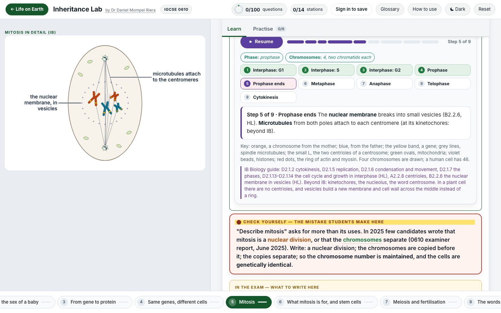

<div align="center">

<h1>🧬 &nbsp;Inheritance Lab</h1>

**Cambridge IGCSE Biology 0610 · Topic 17, Inheritance**

[](https://nlcsbiology.com/inheritance-lab/)


by **Dr Daniel Mompel Riera**

</div>



---

## What a student does

Each station has its own picture on the left and short cards on the right that open one at a time. Press a part of the
picture and its card opens; open a card and its part shows in the picture. The stations follow the T17 revision summary,
in its order and in its words. Then the questions say right or wrong, never the answer.

|  |  |
|---|---|
| 🧬 **14 stations** | chromosomes, genes and alleles · pairs of chromosomes and the sex of a baby · from gene to protein · gene expression · mitosis · what mitosis is for, and stem cells · meiosis and fertilisation · the words of inheritance · genetic diagrams and Punnett squares · the test cross · pedigree diagrams · codominance and the ABO blood groups · sex linkage · crosses to practise |
| ✍️ **100 questions** | type genotypes and Punnett squares · multiple choice · put in order · match up · sort into groups · tick a grid · fill the gaps |
| 🔤 **The letters right** | genotypes are typed with a real raised letter (Iᴬ, Xᵇ), capitals and small letters kept apart; a wrong box says which rule it breaks |
| ♾️ **Crosses without end** | a trainer makes a new cross every time: dominant and recessive, the test cross, codominance, the ABO blood groups and sex linkage |
| ✖️ **A line or a cross?** | a chromosome is a single line in a working cell, a cross only while the cell divides, then two single rods again |
| 🎬 **Step by step** | from a cell to a gene (the DNA copied, coiled into a cross, wound round histones, down to the double helix, each at its real size); how a protein is made, from a gene thousands of base pairs long to the folded protein (the mRNA leaving through a pore, the ribosome's two parts, the small RNAs that bring the amino acids); mitosis and meiosis, each with an IGCSE level and a detailed IB level (every phase, the spindle, centrosomes, crossing over), all drawn the same way; "A line or a cross?", the mother's and the father's chromosome from a thin line to a cross and back. Each step waits for "Next step". The mitosis, meiosis and "What mitosis is for" pictures play as short films |
| 📷 **Real pictures** | a dividing cell under a fluorescence microscope, an embryo of 8 cells, a blood group test, a colour-vision chart |
| 📖 **A shared glossary** | one wording per term, the same in every lab |

> [!NOTE]
> **The right answers are stored only as scrambled fingerprints.** The lab can tell a student they are wrong, but its
> questions cannot show what *right* is. The explanations of the multiple-choice options are published with the lab,
> scrambled, for the pupils whose teacher gives them the Accommodation: each sees an explanation after a second wrong try.
> Someone who unscrambles them could learn an answer.

## Where it sits

Behind the [Life on Earth](https://nlcsbiology.com/life-on-earth-hub/) shelf (Topic 17), one shelf of the
[Biology Hub](https://nlcsbiology.com/biology-hub/) — the front door to every Biology app here. The **← Life on Earth**
button goes back up. The nucleus and the cell membrane are in the [Cells Lab](https://nlcsbiology.com/cells-lab/).

<details>
<summary><b>Behind the scenes</b> — how this lab works, in plain English</summary>

<br>

**Pictures.** The chromosomes, cells, DNA and crosses are drawn for the lab: abstract shapes in flat colours, each in a
key, far larger than real. Nothing drawn crosses the outline it is in, checked frame by frame. The four photographs are
real and credited under the picture, never on the photograph.

**Why the right answers are not in the page.** Each question carries a *scrambled fingerprint* of its answer. When a
student answers, the page scrambles what they did in the same way and compares the two. Scrambling only works one way, so
no fingerprint can say what the right answer is — only *not that one*. A typed genotype is scrambled with its capitals,
small letters and raised letters kept apart, so `Rr` and `rr`, or `Iᴬ` and `IA`, never pass for each other. The real
answers live in one file that is never published.

**What is shared with the other labs.** The question engine, the marking, the saving, the sign-in, the widgets and the
glossary are kept in one place and copied in whenever a lab is rebuilt, so a fix reaches every lab at once. What belongs
to this lab alone is its content and its pictures.

**Rebuilding it** (only needed if you change the content). One command reads the master file with the answers in it and
writes out the published version with only the fingerprints. It refuses to finish unless every answer still marks
correctly. The `tools/` named here stay on Daniel's computer: they are not in this repository.

```
node tools/build.mjs
```

Picture credits: [`assets/photos/CREDITS.md`](assets/photos/CREDITS.md).

</details>

Made by **Dr Daniel Mompel Riera** ·
[dmompelriera@nlcsjeju.kr](mailto:dmompelriera@nlcsjeju.kr)

## Licence

| What | Licence |
|---|---|
| **The software** — everything that runs: JavaScript, HTML structure, CSS, build tools | [AGPL-3.0](LICENSE) |
| **The teaching material** — question text, explanations, diagrams and images I made, wherever they are stored | [CC BY-NC-SA 4.0](LICENSE-CONTENT) |

**In plain English.** Use it, change it, run it for your students — free, and you never need to ask. If you change the
software and let anyone else use it, *including over a network*, you have to publish your source under the same licence.
You may not sell the teaching material or use it commercially, and the credit has to stay.

**Not covered:** third-party images and media keep their own licences — see the picture credits.

© 2026 Dr Daniel Mompel Riera. I hold the copyright, so I can grant other terms: if you want to use any of this
commercially, ask me at <dmompelriera@nlcsjeju.kr>.
